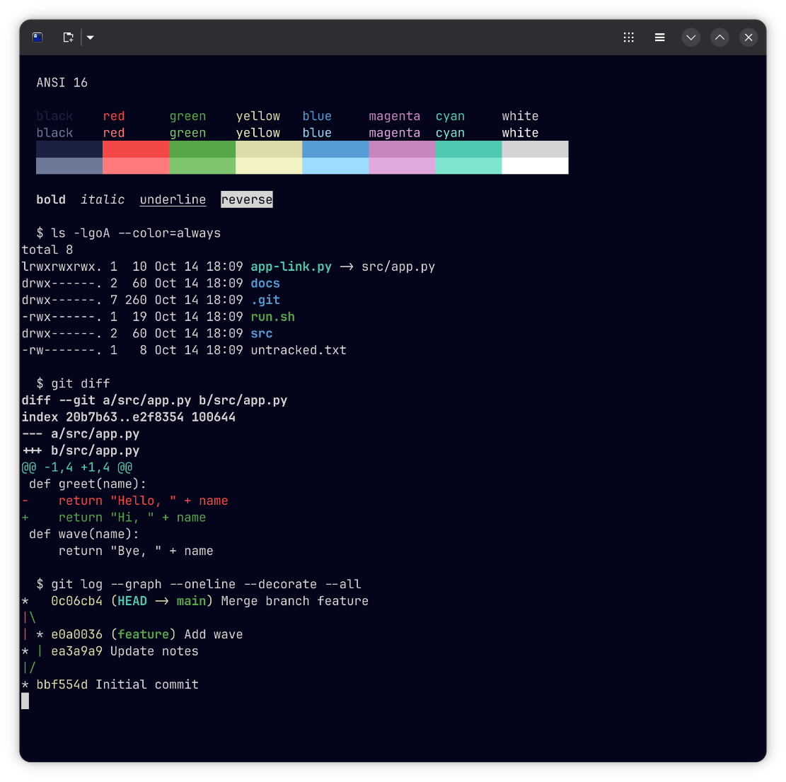

# Deepwick for Ghostty

Deepwick colors for [Ghostty](https://ghostty.org).

> Deepwick is an unofficial theme derived from
> [Polywick Blue](https://vscode.polywickstudio.net) by Polywick Studio (MIT).
> Not affiliated with Polywick Studio.



## Install

```sh
mkdir -p "${XDG_CONFIG_HOME:-$HOME/.config}/ghostty/themes"
cp deepwick "${XDG_CONFIG_HOME:-$HOME/.config}/ghostty/themes/"
```

## Activate

In `${XDG_CONFIG_HOME:-$HOME/.config}/ghostty/config`:

```
theme = deepwick
```

Check it with `ghostty +show-config | grep -E '^(background|foreground) '`.
Colors set in your own config override the theme's.

## Notes

- Split dividers use Overlay.

Tested with Ghostty 1.1.4 (build `1.1.4-main+d0c5191ae`).

## License

MIT. See [LICENSE](LICENSE).
